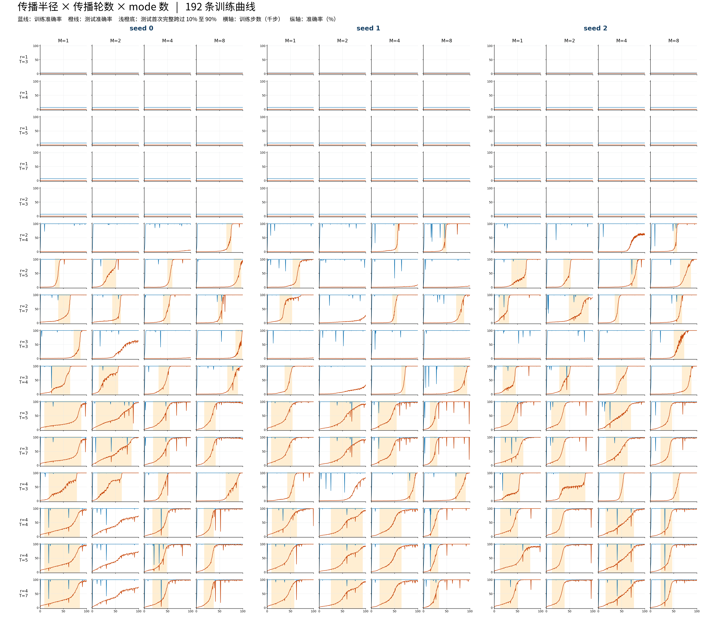
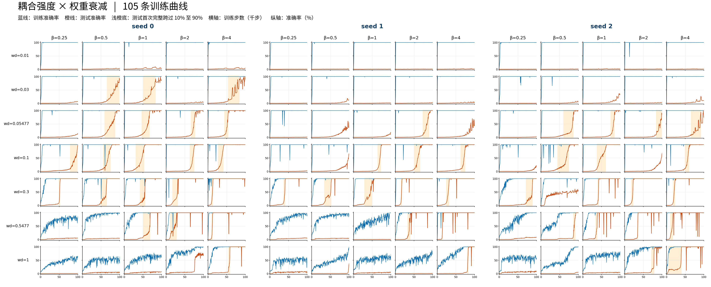
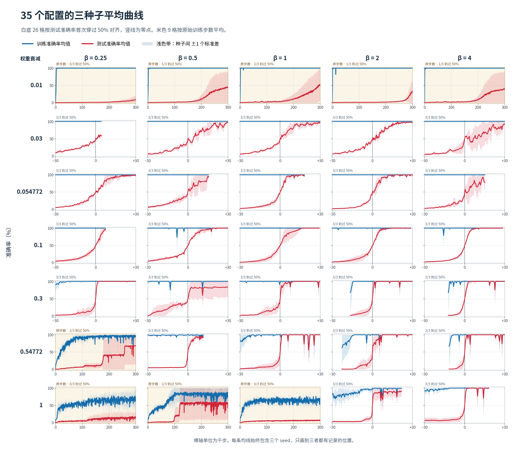

# TGLT-Grokking

第一代局域多 mode 主辅网络的代码与主要结果。
本包对应开放序列、两层、每层先完成传播再更新一次主状态的版本。
代码保留历史原文件。后来的环形余数条和逐 sweep 主状态更新版本不在本包中。

## 先看什么

- [论文草稿原文](paper/sn-article.tex)（[来源与配套文件说明](paper/README.md)）
- [第一代模型与实际训练设置](docs/architecture.md)
- [主要结果及证据范围](docs/results.md)
- [内部指标的定义](docs/metrics.md)
- [全部运行索引](experiments/run_index.csv)
- [原始源码](src/exp2_sequence_local_grokking.py)

| 数据批次 | 配置 | seed | 运行数 | 记录范围 |
|---|---|---|---:|---|
| 架构扫描 | r=1,2,3,4；T=3,4,5,7；M=1,2,4,8 | 0,1,2 | 192 | 全部0–100k |
| 耦合强度×权重衰减扫描 | β=0.25,0.5,1,2,4；7档权重衰减 | 0,1,2 | 105 | 78条0–300k；27条0–100k |

两批共297条运行。续训属于原运行，不另算新运行。各运行含配置、数据划分和无损压缩的完整训练记录。
本次整理没有新增训练，没有改模型，没有改历史标签和跃迁窗口。

## 主要图

完整图片清单与数据对应见[结果说明](docs/results.md)。







## 如何核对和重画

以下命令只读取现有文件，使用CPU。

```bash
python scripts/verify_package.py
python scripts/check_model_cpu.py
python scripts/redraw_saved_results.py --kind seed_means
python scripts/redraw_saved_results.py --kind ablation
```

`verify_package.py`使用Python标准库。其余脚本依赖`requirements.txt`。
本次验证环境为Python 3.8.20、PyTorch 2.4.1、NumPy 1.24.4、Matplotlib 3.7.5。
重画文件写入`reproduced/`，不覆盖保留的主图。
原图的绘制代码保存在`provenance/historical_scripts/`。这些历史脚本带有原服务器路径，不是跨机器直接运行的入口。

## 范围与限制

当前证据支持：这一架构可以出现严格判据下的Grokking；写回组织随学习变化；单独保留一路写回通常不能维持完整模型的测试表现。
这些结果没有证明标准Transformer与本网络完全等价，也没有证明热力学相变。

规则写入强度使用任务答案作投影参照。写回方向关联差异不使用答案，但使用完整59×59输入网格，其中包含测试输入。
测试达到90%与严格Grokking分开记录。历史源码自带的`classic_metrics`采用较早的宽松口径，不能替代本包保留的严格标签。

大型模型检查点和激活数组仍在研究服务器。本包不含权重，所以能核对历史记录和重画结果，不能仅靠本包独立重放所有内部状态。
原始数据位置与文件哈希见`provenance/source_files.csv`。任何历史路径都只作来源记录。

本包暂未添加开源许可证。仓库用于私人研究整理。
