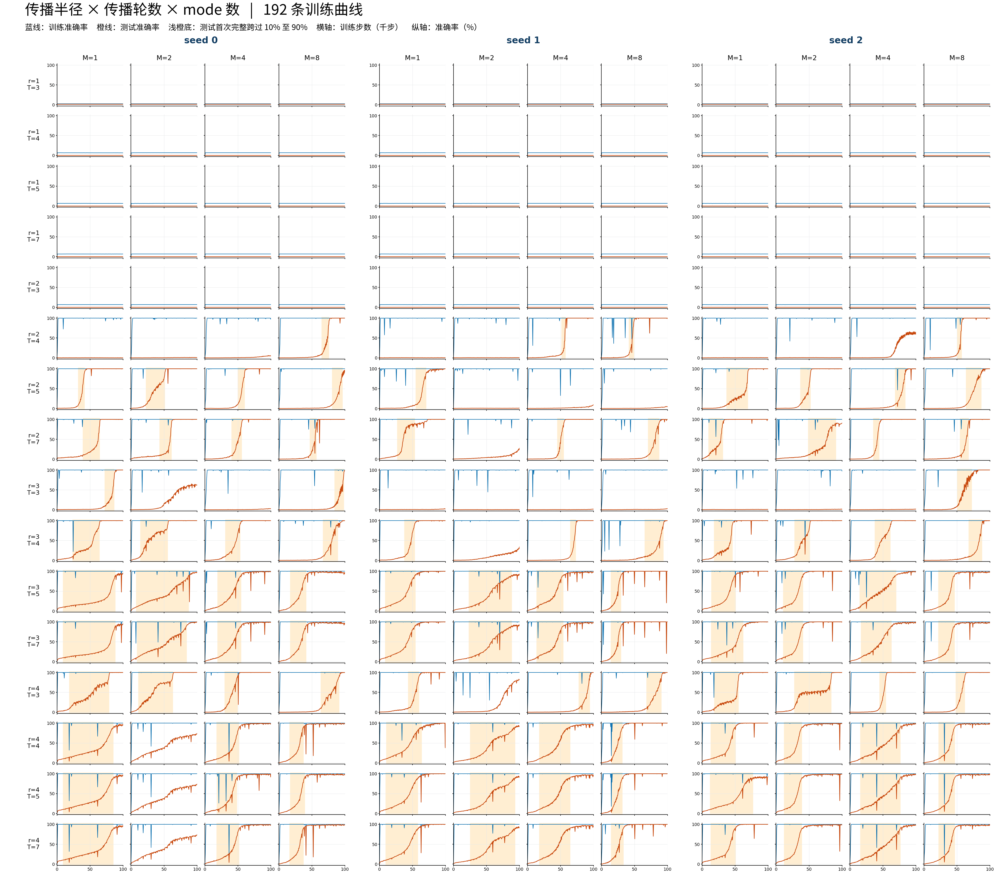
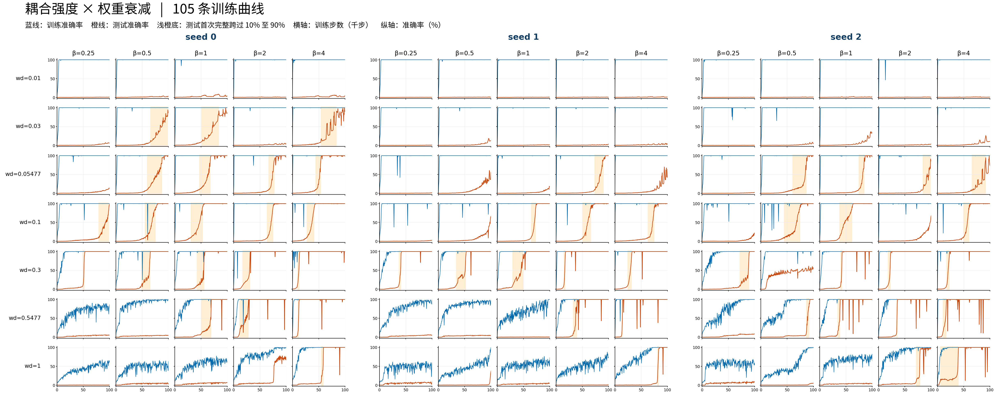
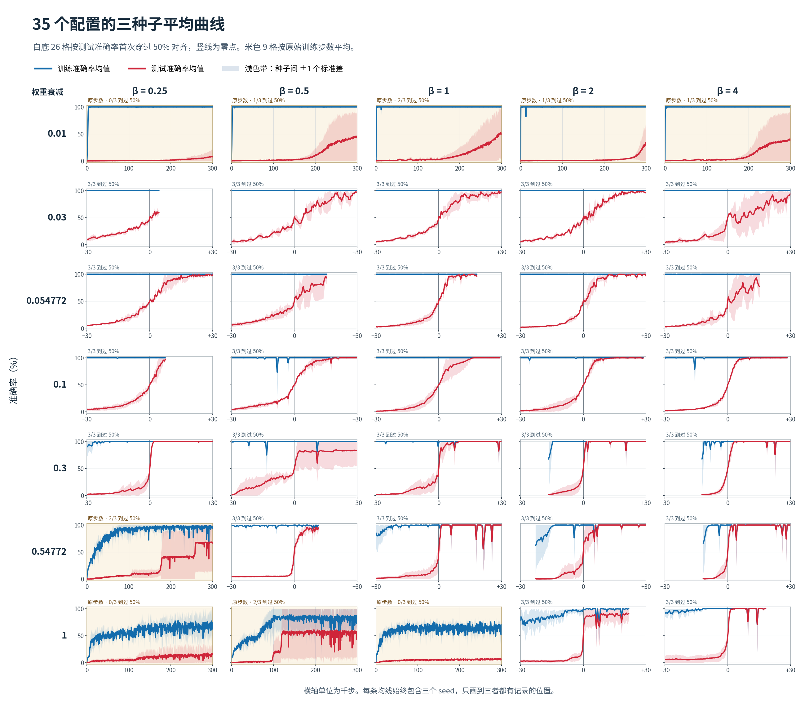

# TGLT-Grokking

第一代局域多 mode 主辅网络的代码与主要结果。
本包对应开放序列、两层、每层先完成传播再更新一次主状态的版本。
代码保留历史原文件。后来的环形余数条和逐 sweep 主状态更新版本不在本包中。

## 先看什么

- [最新：局部窗口 Transformer 对照代码与结果（2026-11-15）](experiments/transformer_window_bridge_20261115/)
- [论文草稿原文](paper/sn-article.tex)（[来源与配套文件说明](paper/README.md)）
- [第一代模型与实际训练设置](docs/architecture.md)
- [主要结果及证据范围](docs/results.md)
- [内部指标的定义](docs/metrics.md)
- [全部运行索引](experiments/run_index.csv)
- [原始源码](src/exp2_sequence_local_grokking.py)

| 数据批次 | 配置 | seed | 运行数 | 记录范围 |
|---|---|---|---:|---|
| 架构扫描 | r=1,2,3,4；T=3,4,5,7；M=1,2,4,8 | 0,1,2 | 192 | 全部0–100k |
| 耦合强度×权重衰减扫描 | β=0.25,0.5,1,2,4；7档权重衰减 | 0,1,2 | 105 | 78条0–300k；27条0–100k |

两批共297条运行。续训属于原运行，不另算新运行。各运行含配置、数据划分和无损压缩的完整训练记录。
原始 297 条记录的整理没有新增训练，也没有改历史模型、标签和跃迁窗口。后续新增对照单独列在下文。

## 主要图

完整图片清单与数据对应见[结果说明](docs/results.md)。







## 如何核对和重画

以下命令只读取现有文件，使用CPU。

```bash
python scripts/verify_package.py
python scripts/check_model_cpu.py
python scripts/redraw_saved_results.py --kind seed_means
python scripts/redraw_saved_results.py --kind ablation
```

`verify_package.py`使用Python标准库。其余脚本依赖`requirements.txt`。
本次验证环境为Python 3.8.20、PyTorch 2.4.1、NumPy 1.24.4、Matplotlib 3.7.5。
重画文件写入`reproduced/`，不覆盖保留的主图。
原图的绘制代码保存在`provenance/historical_scripts/`。这些历史脚本带有原服务器路径，不是跨机器直接运行的入口。

## 新增：局部窗口 Transformer 机制对照

`src/exp2_window_transformer.py` 提供标准动态四头注意力模块；实验入口在
`experiments/transformer_window_bridge_20261115/`。这是新增实验，与上面的历史 297 条运行分开记录。

- 原模 59 加法、输入位置 0/7、查询位置 15，原始划分 870/2611，split seed=0。
- 两层、宽度 64、4 heads、FFN=256、GELU、post-LayerNorm、无 dropout。输入嵌入及查询读出与同 seed TGLT 完全相同初始化。
- 窗口 W=7/8/12/15/全局，各 seed 0/1/2，100k 步。全批 AdamW，lr=0.001、wd=0.1、betas=(0.9,0.98)，100 步预热，梯度裁剪 1；偏置和 LayerNorm 不衰减。
- 每 500 步保存模型、优化器、随机状态和完整曲线。W=15 与全局的可见范围相同，作为实现一致性对照分别保留，不能合成六个独立 seed。
- TGLT 为 62,787 参数，Transformer 为 109,051 参数。本实验对齐输入、读出、宽度和层数，不是等参数量比较。

正式实验原件位于服务器 `/home/chenzhe/work/tglt_experiments/experiments/firstgen_transformer_bridge_20261115/`。
训练环境为 `/home/chenzhe/.conda/envs/risk-exp4/bin/python`；SwanLab 环境为项目根目录 `.venv-swanlab/bin/python`。
记录保存在独立的 `swanlab/logs`，本地转发后查看 http://127.0.0.1:16097/charts。

在服务器的实验目录中，`validate.py` 核验数据、标准层等价性、梯度与窗口可达性；
`pipeline.py` 派发预设的 15 条运行；`train.py --window 8 --seed 0 --gpu <允许的完整GPU UUID>` 可执行其中一条。
已有运行目录受保护，不覆盖。恢复单条运行使用 `--resume`，核验配置、数据哈希并恢复优化器与随机状态。

`analyze.py` 用同一套函数分析 TGLT 和 Transformer。旧 TGLT 权重根目录可通过环境变量
`TGLT_SOURCE_ROOT` 指定；原目录包含 `week/v1/results/`。分析不训练模型。
`postprocess.py` 生成结果图与统计表，`verify.py` 核验完整保存点、优化器步数、终点 CPU 回放和 SwanLab 标量。

机制量的口径：

1. 写回份额：第二层查询位每条 Mode/Head 写回的均方根强度，除以四条强度之和。
2. 条件 Margin 分解：每道题固定 100k 时的最强错误类，冻结当前完整模型的 LayerNorm 分母；Transformer 额外冻结 GELU 的乘性增益。这是可精确重建原 Margin 的条件分解。
3. 实际消融：仅保留一个第二层通道，或两层都仅保留同编号通道；重新计算注意力、MLP 和 LayerNorm。
4. 位置替换：将 a 或 b 加 1（模 59），只替换一个位置的第一层状态，再完整重算后续输出。各位置的影响强度归一化为份额；这些单位置干预不是可加的因果分解。W=8 时 a 只能通过位置 7/8 中继，这是架构约束。
5. 无完整 10%→90% 跃迁的运行不虚构事件时刻：使用同 seed TGLT 的事件附近保存点；两者都无完整跃迁时使用 25k/50k/100k，并在表中保留标签。


完成结果（100k；每组3个seed）：

| 模型 | 范围 | 达到测试90% | 严格Grokking | 终点测试均值 | 10%→90%宽度中位数 |
|---|---|---:|---:|---:|---:|
| TGLT | H=7 | 0/3 | 0/3 | 0.00% | 未形成 |
| TGLT | H=8 | 1/3 | 1/3 | 56.64% | 6,000步（1条） |
| TGLT | H=12 | 3/3 | 1/3 | 99.97% | 22,500步（3条） |
| TGLT | H=15 | 3/3 | 0/3 | 99.29% | 40,500步（3条） |
| Transformer | W=7 | 0/3 | 0/3 | 0.00% | 未形成 |
| Transformer | W=8 | 0/3 | 0/3 | 0.22% | 未形成 |
| Transformer | W=12 | 0/3 | 0/3 | 0.20% | 未形成 |
| Transformer | W=15 | 0/3 | 0/3 | 13.76% | 未形成 |
| Transformer | 全局 | 0/3 | 0/3 | 13.76% | 未形成 |

TGLT使用原位置0/7/15的已有运行；没有混入查询位置11的几何移位实验。W=7的三个seed终点训练准确率均为6.78%，其余Transformer均为100%。W=15与全局版本在三个seed上的完整曲线和终点权重逐项相同，应视为一致性核验，不增加独立样本数。

在本轮协议下，几何可达并不足以产生Grokking。位置替换显示两类模型都利用中继位置，但Transformer未学会泛化；其机制分析使用同seed TGLT的对应时刻，不能称为Transformer的跃迁前后。Attention Head编号也不对应TGLT的衰减尺度编号。

结果入口：

- [全部15条Transformer曲线](experiments/transformer_window_bridge_20261115/results/01_Transformer全部训练测试曲线.png)
- [TGLT与Transformer三种子均值对照](experiments/transformer_window_bridge_20261115/results/02_TGLT与Transformer平均曲线.png)
- [Mode/Head条件贡献及写回份额](experiments/transformer_window_bridge_20261115/results/03_Mode与Head机制对照.png)
- [H/W=8全部seed](experiments/transformer_window_bridge_20261115/results/04_H08_全部seed的条件贡献.png)、[H/W=12全部seed](experiments/transformer_window_bridge_20261115/results/04_H12_全部seed的条件贡献.png)
- [第一层反事实位置替换](experiments/transformer_window_bridge_20261115/results/05_第1层反事实位置替换.png)、[终点单通道消融](experiments/transformer_window_bridge_20261115/results/06_终点单Mode与单Head消融.png)
- [中文配置汇总](experiments/transformer_window_bridge_20261115/results/配置汇总.csv)、[逐运行统计](experiments/transformer_window_bridge_20261115/results/per_run_summary.csv)、[机制完整数据](experiments/transformer_window_bridge_20261115/mechanism/curves.csv)

验证通过：15条训练、3,015个完整检查点；12条机制分析、1,812个检查点；终点CPU回放的正确题数全部一致；条件分解最大重建误差1.18e-12以内；SwanLab共18,090个标量逐值匹配原日志。验证记录在实验目录的 `validation/completion_checks.json`，检查点位置及SHA256在 `validation/checkpoint_manifest.csv`。

仓库内的 `histories/` 与 `mechanism/*.csv` 可以直接重画全部7张图，无需模型权重：

```bash
cd experiments/transformer_window_bridge_20261115
python postprocess.py --saved
```

## 范围与限制

当前证据支持：这一架构可以出现严格判据下的Grokking；写回组织随学习变化；单独保留一路写回通常不能维持完整模型的测试表现。
这些结果没有证明标准Transformer与本网络完全等价，也没有证明热力学相变。

规则写入强度使用任务答案作投影参照。写回方向关联差异不使用答案，但使用完整59×59输入网格，其中包含测试输入。
测试达到90%与严格Grokking分开记录。历史源码自带的`classic_metrics`采用较早的宽松口径，不能替代本包保留的严格标签。

大型模型检查点和激活数组仍在研究服务器。本包不含权重，所以能核对历史记录和重画结果，不能仅靠本包独立重放所有内部状态。
原始数据位置与文件哈希见`provenance/source_files.csv`。任何历史路径都只作来源记录。

本包暂未添加开源许可证。仓库公开展示第一代模型的代码与研究结果。
