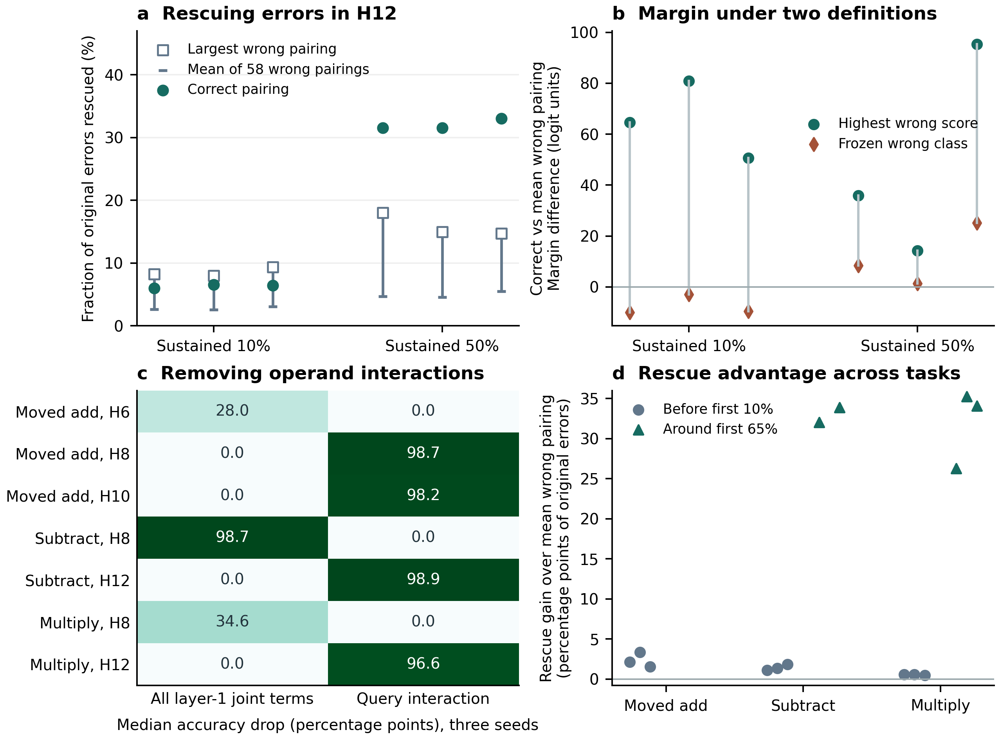

# TGLT 的 PNAS 投稿前证据复审

2026 年 11 月 23 日

## 交付判断

**证据足够支撑一篇以受控局域算术模型为范围的 PNAS 投稿初稿。** 建议用两个结果组织正文。同初值下改变传播范围，可改变受检模型依赖的双输入计算位置。同一条训练轨迹中，局域正确配对可以先表现为局部优势，随后对原错题的纠错作用更稳定。后者现在有一条慢而最终高泛化的独立初始化复核，并获得其他布局和运算的同方向参照。广泛意义在于能把信息到达、信息组合和正确决策变成可分别检查的问题。证据范围为所测局域架构、固定划分与合成任务。数据与代码须在正式投稿时说明开放或访问安排。 [PNAS 投稿指南](https://www.pnas.org/author-center/submitting-your-manuscript) · [PNAS 编辑及数据政策](https://www.pnas.org/author-center/editorial-and-journal-policies)

## 第一轮复核从单条慢轨迹扩展到三个种子

复用 H12、β=0.25、权重衰减 0.03 的已有模型，共 39 个检查点。沿用当步分类器和权重，只在查询位置对双输入交互增添 0.25、0.5 或 1 倍的自身信号。对照保留原交互并额外加入错配的第二加数因子，逐题匹配进入 LayerNorm 前去均值向量的 L2 范数，八个错配偏移按固定列表遍历。报告原错转对、原对转错、留出交叉熵，以及正确类别相对最强错误类别和相对干预前固定错误类别的分差。

种子 1 在第 201,000 步持续达到 10%，第 237,000 步持续达到 90%。第一个节点加倍本题交互救回 162 道错题，八种错配救回 38–128 道。按固定错误类别比较，平均分差优势为负。第 228,500 步的持续 50% 锚点，本题加倍救回 338 道，八个错配中最多为 122 道，两种分差口径均为正。种子 2 在 300,000 步仍为部分泛化，继续保留这一例及其更早的负对照。

为检查分母变化，以每条轨迹在持续 10% 和持续 50% 时都答错的试题为同一个集合。三个种子的共同错题分别是 1,218、986、1,191 道，其中只在本题加倍时答对，且八种错配和删除均不纠正的题数分别由 10 增至 223、10 增至 164、22 增至 181。这是事后固定题集上的敏感性对照，推断单位仍是三个训练种子。

## 第二轮复审与补实验跨布局和运算验证位置

冻结 27 个末期检查点，对每个第一层位置做双输入交互删除，也测试一并删除第一层全部此类项。在查询位置第一层尚无法直接接收第一个输入时，另删除源自首个加数的到达信号与当地第二个加数因子的指定乘积。

- **移位加法。** 输入在 0、5，查询在 11。H=6 的三个种子均最依赖第一层位置 5，全删第一层双输入项后分别只答对 20、12、27 道。H=8 和 H=10 的六条轨迹在同样的第一层删除下保持答对数，删除查询交互后只答对 32–46 道。H=6 与 H=10 在各自种子内都使用相同训练设备及初始参数。H=11 和 13 的第一层联合项删除也没有改变正确数。当第一个输入可以直接抵达查询端，本文用于孤立指定查询乘积的分解条件改变，查询项结果留空。
- **原布局减法与乘法。** 三个种子各有 H=8 与 H=12 的配对，检查点初始参数逐项一致，配置只变每轮半径和运行目录。两种运算中，所有 H=8 模型都最依赖第一层位置 7，所有 H=12 模型都对查询交互删除敏感。H=12 删除后每个减法模型答对 22–28 道，乘法的三个模型各答对 87 道。乘法含零这一特殊类别，删除后的正确数应按实际结果报告。低泛化种子也保留在逐运行表中。

另复用移位加法 H8、减法 H12 和乘法 H12 的各三个种子做跨任务时间检验，共 53 个检查点。三种设置在首次过 10% 之前和首次过 50% 左右，九条轨迹的本题救回数都高于各自八种错配的平均值。过 10% 之前有 5/9 条超过最强错配，首次过 50% 左右有 9/9 条超过最强错配。遇到原历史的首次过线点没有保存权重，使用该时刻后最早保留的检查点，过线前用目标时刻以前最后保存的检查点。原事件时间和实际回放时间均入表。首次过 50% 的锚点按历史选择，保留权重上的准确率可能已回落。

## 第三轮更严的错配与分解检查

在 H12 三个种子上把错配扩至所有 58 个非零模 59 偏移，同时分别用全输入网格和仅训练题估计到达信号在给定第二加数时的均值。使用训练题时，59 个第二加数都在训练集中。以下是加倍本题交互、训练题均值下的结果。

| 种子 | 持续 10% 时本题救回 | 58 个错配的平均／最大救回 | 持续 50% 时本题救回 | 58 个错配的平均／最大救回 |
|---|---:|---:|---:|---:|
| 0 | 139 | 61.5／191 | 411 | 60.8／235 |
| 1 | 154 | 60.3／187 | 324 | 47.2／154 |
| 2 | 149 | 71.7／217 | 417 | 69.8／186 |

两种估计口径下，持续 10% 时三个种子的本题救回数都高于错配均值，也都低于最强错配。此时相对最强错误类别的平均分差优势为正，相对干预前固定错误类别的优势为负。持续 50% 时，本题救回数均超过全部错配，两种分差优势均为正。数值使用相应时点的原错题计算。两种分差观察说明干预会重新排列错误类别的分数。用其中一个分差读数来确定正确计算的首次形成时刻仍缺少依据。

图中 a、b 使用 H12 三个种子和训练题均值。每个阶段三个点由左到右是种子 0、1、2。a 的线段表示 58 种错配的平均至最高救回比例。b 比较本题操作与错配平均。c 是三个种子的中位准确率降幅。d 的每个点对应一个训练种子，错配基线为八个偏移的平均值。

## 复核和正文范围

119 次模型与检查点回放由 39 个 H12、27 个位置实验和 53 个跨运算或布局的时间实验组成。后两组共享部分末期检查点，重复回放不计成独立种子。所有拆分的原前向均与原生前向数值对比。与归档训练正确数比较，39 个 H12 检查点中只有两个各相差一道留出题。其余 80 次与日志计数一致。两组计数与实际比较阶段均保存在数据表中。

正文可以提出三层证据。第一，传播范围会改变受检模型采用的运算位置。第二，正确配对相对于对照的纠错优势随阶段更可靠。第三，已有五种子训练干预支持早期数字表示的排列可以改变等待到持续 10% 的时间。论文可以用第一和第二项构成中心发现，第三项用来检验一种影响等待的训练因素。更普遍的模型动力学、预测某个初始化何时泛化、或从常规架构推广到现实任务，需要对应证据。

与已有工作的差异应写具体。Nanda 等已用傅里叶消融和进度量发现可泛化计算会在准确率跃升前形成。本工作的新增证据是改变通信半径造成的空间位置差异，以及固定权重和原读出时，正确配对相对错配如何改变同一道错题和错误类别的排序。 [Nanda 等，§4.4–5](https://arxiv.org/html/2301.05217)

## 数据与复现入口

服务器项目根目录为 `/home/chenzhe/work/tglt_experiments`。新实验在 `analysis/pnas_evidence_20261123/`，保存 `round1_protocol.json`、逐条件结果、逐题档案、时间锚点、汇总与制图入口。使用 `risk-exp4` 的 Python 3.8.20 和 PyTorch 2.4.1 CPU 重放。完整历史权重、配置和数据划分位于原始实验目录，可用结果表中的 SHA-256 对照。训练日志是达标锚点的来源，重新计算得到表中各干预的诊断值。SwanLab 本地看板在 `http://127.0.0.1:16225/charts`，以服务器该端口转发访问。已核对 21 条记录的 446 项数据。
