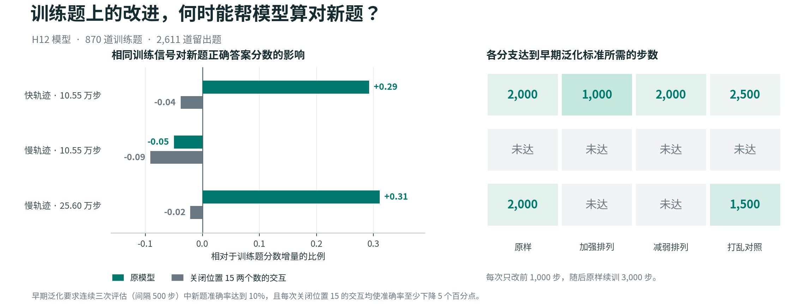
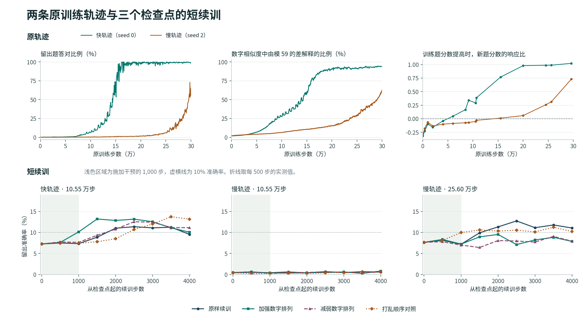

# 实验 A · 为什么一条轨迹更早学会合并两个数

在同一个模 59 加法模型中，快轨迹较早到达了一种状态。在这时，提高训练题正确答案分数的微小更新，也会提高没见过的数字组合的正确答案分数。到相近的泛化阶段，慢轨迹也表现出这种能力。在两条轨迹的相应检查点，正向效果都依赖第二层位置 15 合并两个数的运算。干预数字表示能改变快轨迹进入早期泛化的时间，对慢轨迹的作用随检查点而变。两条原轨迹有 150,500 步的差距，其中多少由数字表示、查询运算或早期优化条件造成，仍未确定。

[实验 A 两页梳理（Word，含四张三线表）](results/实验A_H12_设计与结果.docx)

原模型有两层，每层的信息最多传播 12 格（H12）。第一个数 a 在位置 0，第二个数 b 在位置 7，模型在位置 15 给出答案。两个种子共用 870 道训练题和 2,611 道留出题。按每 500 步评估、连续三次达到给定准确率来计算，原轨迹首次达到 10% 的时刻为 107,500 步和 258,000 步，达到 50% 的时刻为 144,500 步和 296,000 步。快轨迹在 155,000 步达到 90%，慢轨迹在 300,000 步的记录内未达到这一标准。



## 用同样的训练信号检验两条轨迹

去掉训练误差大小的影响，给两个模型完全相同的要求。对原来的 870 道题，沿提高正确答案相对全部 59 个答案平均分的方向作微小更新，每个答案类权重相等。下表的响应比是留出题平均分数增量除以训练题平均分数增量。负号表示这批新题的正确答案平均失分。对相同的参数位移，关闭位置 15 的特定交互后再算一次留出分数。构造更新只用训练题，留出题只在评估时使用。

| 原模型及检查点 | 训练答对 | 留出答对 | 原模型响应比 | 关闭位置 15 交互后的响应比 |
|---|---:|---:|---:|---:|
| 快轨迹，105,500 步 | 870 | 190 | +0.292 | −0.038 |
| 慢轨迹，105,500 步 | 870 | 12 | −0.050 | −0.091 |
| 慢轨迹，256,000 步 | 870 | 200 | +0.311 | −0.021 |

位置 15 的这项运算用含 b 的查询状态，调制传到这里、随 a 改变的信号。关闭时只扣除这部分乘性交互，重新计算归一化和最终分类。早在 85,000 步，快、慢轨迹的响应比就已分别为 +0.168 和 −0.075。把正向响应换算成百分比准确率会混淆两种量。这项测量检验当前模型如何传递一个统一的训练信号，历史 AdamW 单步另有直接核对。

精确定义为 R = ⟨∇S训练, ∇S留出⟩ / ‖∇S训练‖²，其中 S 是按答案类别等权平均的“正确答案分数减该题的平均分”。关闭交互后保留原来的更新方向和分母。两条轨迹各抽取 15 个时刻，另有标签置乱、按参数组拆分及双边微扰检查。24 个检查的实测响应与梯度公式最大相差 5.35×10⁻⁸。[逐时刻、逐参数组的响应](results/training_response.csv)

## 改变哪个因素能让模型提早泛化

每个数字有一个学习得到的向量。我们考察两个数字的相似程度能否由它们的模 59 差值解释。例如 2 和 5、17 和 20 都相差 3。若共同的差值能稳定预测两对数字的相似程度，这种排列就较强。指标 ρ 是中心化数字向量的内积在不同数字对上的方差中，由模差解释的比例。均匀放大或旋转所有数字向量都不改变它。

两条轨迹的起点接近。到 20,000 步，ρ 为 2.70% 和 3.07%。到 85,000 步，快轨迹升到 21.45%，慢轨迹为 5.43%。这段期间，两条轨迹的数字相似关系累计变动量相近，分别为 3.66 和 3.50 弧度。沿模差方向取得的净进展与累计变动量之比，快轨迹约为慢轨迹的 5.1 倍。这里每 500 步记录一次相似关系，把中心化相似度矩阵的非对角元素归一化成单位向量，沿连续保存点累加夹角。向模差子空间的净进展量由 arcsin(√ρ) 的首尾差给出。[原轨迹的 1,202 个保存点](results/original_embedding.csv) · [累计变化](results/original_intervals.csv)

从三个原检查点各分出四条短续训。前 1,000 步，只把 59 个数字向量的更新方向调整 15°，目标分别为加强模差排列、减弱排列、朝打乱数字顺序的方向调整，另保留原样续训。这里的 15° 作用于去均值、去径向后的更新。保留原更新的平均位移、径向分量及长度，优化器动量和其他参数照常更新。四组随后都按原算法续训 3,000 步。干预利用了已知的模 59 结构，损失只用原训练集。

| 原检查点 | 原样 | 加强排列 | 减弱排列 | 打乱顺序 |
|---|---:|---:|---:|---:|
| 快轨迹，105,500 步 | 2,000 | 1,000 | 2,000 | 2,500 |
| 慢轨迹，105,500 步 | 未达 | 未达 | 未达 | 未达 |
| 慢轨迹，256,000 步 | 2,000 | 未达 | 未达 | 1,500 |

表中是距检查点的步数，取三个连续合格评估点中的第一个。每隔 500 步评估一次，要求留出准确率至少 10%，且关掉位置 15 的交互后至少下降 5 个百分点。“未达”表示到第 4,000 步仍未观察到三个连续合格的评估点。单用准确率过线，三组四个分支分别得到同样的结果。三个起点是根据原轨迹选定的，第一和第三个起点都在各自原轨迹达到早期标准前 2,000 步。中间一组用同一个时钟作对照。

撤除干预后的 30 次评估，快轨迹原样和加强的平均准确率分别为 10.17% 和 12.23%，慢轨迹晚期则为 11.26% 和 8.56%。各分支全程训练答对数至少 866/870。准确率提高也可能伴随个别错误更自信，例如快轨迹在干预结束时原样和加强的留出交叉熵分别为 11.40 和 129.03。相同角度在不同模型实际改变的排列程度不同，慢轨迹晚期干预后的 ρ 从原样的 32.4% 增至 42.1%，仍未提前过线。[12 条分支的过线时刻与训练后表现](results/branch_outcomes.csv) · [每 100 步的准确率、交叉熵、分类间隔和内部量](results/branch_curves.csv)



## 两项补充核对

- **把加强过的数字向量单独装回原样分支。** 在干预结束的第 1,000 步，保留快轨迹原样分支的其余参数，只换入同一起点、加强分支的 59 个数字向量，留出答对数从 192 增至 287，训练题都是 870 道全对。慢轨迹在相同步数做同样替换，答对数为 11→11，在晚期为 188→205。各分支实际产生的向量改变量不同。这支持快轨迹在该状态下可以利用数字排列。各参数之间的配合仍影响实际结果。[组内参数替换的 60 项结果](results/pulse_swaps.csv)
- **交换真实训练误差。** 在接收模型的原设备、原参数、原动量和裁剪配置下，把交叉熵对每道训练题各答案分数的梯度，替换成另一种子的相同坐标。另设原样、回填自身误差、当前误差清零但保留历史动量和权重衰减、供方误差按接收方范数缩放。在 107,000 步，快模型正常一步多对 7 题，换入等强的慢模型误差后多对 1 题。慢模型正常一步答对数不变，换入等强的快模型误差后也不变。跨全部抽查时刻，各效应大小和符号并不恒定。比较 6 对时刻的两个交换方向，自身误差回填全部逐参数复现原更新。这项检验只涉及实际的一步。[快轨迹接收误差](results/error_swap_b0.25_wd0.03_s0.json) · [慢轨迹接收误差](results/error_swap_b0.25_wd0.03_s2.json)

## 运行与核对

实验范围是原 H12 两条轨迹（β=0.25，权重衰减 0.03，seed 0 / 2）。原始检查点、模型源码和训练集划分的路径与哈希见上轮的 `../relay_learning_20261118/results/trajectories.csv` 及本轮 `records/*/meta.json`。预先固定的干预与判据见 `protocol.json`，服务器提交 `834f4f76adb1`。历史几何、统一训练信号、组内替换和真实训练误差互换为配套诊断。三组原样续训的 27 个共同记录点与历史训练及测试答对数全部相等。第 1,000 和 4,000 步共六份原样权重均与对应历史权重逐项相等。[核验记录](results/validation.json)

服务器实验目录为 `/home/chenzhe/work/tglt_experiments/TGLT-Grokking/experiments/relay_waiting_20261119`。CPU 分析沿用 `/home/chenzhe/.conda/envs/risk-exp4/bin/python`，GPU 续训沿用 `/opt/anaconda3/bin/python` 和 PyTorch 2.5.1+cu121。以下命令在实验目录执行。每个分支的 `.branch_state/` 保存优化器、随机状态、结束时的权重和可恢复的历史；已完成的分支会跳过。训练结果和评估日志共用本实验目录。

```sh
cpu=/home/chenzhe/.conda/envs/risk-exp4/bin/python
gpu=/opt/anaconda3/bin/python
a800=GPU-70b6fceb-c7c4-9467-3c81-097c9284c160
h100a=GPU-6b53c3c2-3071-5dfb-f306-2f2f142f8009
h100b=GPU-9a72820b-a8c2-0a94-2297-4f65afc67eb0

"$cpu" validate_order.py
"$cpu" history.py
CUDA_VISIBLE_DEVICES="$a800" "$gpu" branch.py fast_same_time
CUDA_VISIBLE_DEVICES="$h100b" "$gpu" branch.py slow_same_time
CUDA_VISIBLE_DEVICES="$h100a" "$gpu" branch.py slow_matched_stage
"$cpu" response.py
"$cpu" swaps.py
CUDA_VISIBLE_DEVICES="$a800" "$gpu" error_swap.py b0.25_wd0.03_s0 extract
CUDA_VISIBLE_DEVICES="$h100a" "$gpu" error_swap.py b0.25_wd0.03_s2 extract
CUDA_VISIBLE_DEVICES="$a800" "$gpu" error_swap.py b0.25_wd0.03_s0 apply
CUDA_VISIBLE_DEVICES="$h100a" "$gpu" error_swap.py b0.25_wd0.03_s2 apply
"$cpu" summarize.py
"$cpu" plot.py
```

SwanLab 0.10.5 使用服务器原有的 `.venv-swanlab` 环境。`monitor.py` 在各分支完成后记录曲线，本地 watch 使用 `swanlab/logs`，监听端口 16104。`monitor.py --verify` 将 12 条曲线的 492 次评估、5,904 项标量逐一与原始记录核对。首次重建结果时，在 `summarize.py` 之前完成 SwanLab 记录和核验。Mac 通过 SSH 转发查看。[本地看板](http://127.0.0.1:16104/charts) · [看板核验记录](results/swanlab_validation.json)
