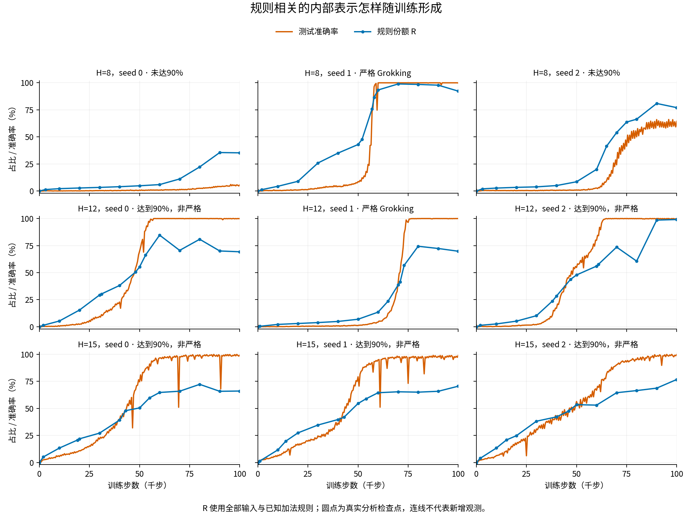

# 训练如何改变规则相关的内部表示

本轮问题：实际 AdamW 更新怎样改变不同输入之间共享的规则表示？采用第一代原位置0/7/15、H=8/12/15的全部三个seed，共九条已有运行。先分析已有检查点，不启动新训练。运行名单和冻结的原严格标签在 roster.json，数值协议在 config.json。

## 表示与观测量

取第二层查询位、该层LayerNorm之后、最终LayerNorm和分类器之前的64维表示 f(a,b)。对全部3481个输入均匀平均。令 y=(a+b) mod59，X=f-E[f]，P X=E[X|y]。

P是输入变换(a,b)→(a+r,b-r)的群平均，也是正交投影。定义B=E||P X||²、W=E||(I-P)X||²、R=B/(B+W)。B测同答案输入共享的表示分量，W测同答案内部剩余差异。R使用已知任务规则和全部输入，包括留出输入。它是事后机制量，不是无标签预警，也不要求所有成功分类器都具有同一个R阈值。B、W的“能量”仅指平方范数，不是热力学能量。

这个结构位于输入组合空间，不是16个序列位置之间的空间关联。只观察R上升不能区分共享分量增强与其余分量收缩，因此同时保存B与W，以及测试Margin、CE和准确率。记录总写回的同口径R作为补充。

本轮test_margin定义为测试集平均的 z_y−logsumexp(z_c,c≠y)，即平滑对数优势，和2026-11-14归因中的Q同口径。它不同于 z_y−max(z_c,c≠y) 或固定错误类Margin，不能直接与机制桥的这些量合并。

## 实际更新与归因

从完整检查点恢复模型、AdamW一阶和二阶矩、参数组。用原870个训练输入重算全批梯度并按原规则裁剪。根据原学习率、偏置校正和eps，分解下一步参数位移为当前梯度项、历史一阶动量项和解耦衰减项。三个项共用真实下一步二阶矩分母。

枚举这三个固定参数位移的全部八种组合，对每种组合完整重算前向、双线性项和LayerNorm。按全部顺序平均边际变化，得到三个分量的Shapley归因；其和严格重建本次有限更新的观测量变化。这是固定更新向量的分摊，不是改变优化器后重新训练的因果效应。

每个检查点均把三项相加结果与PyTorch optimizer.step核对。原权重和优化器状态只在内存中使用，不写回。所有计算为CPU float64；它重建保存状态处的虚拟下一步，不声称逐位重现原CUDA轨迹。保存点的单步变化不能积分成两个检查点之间的累计作用。

## 有限变化的结构方程

令ΔX为一次更新造成的中心化表示变化。则

- ΔB=2 E〈PX,PΔX〉+E||PΔX||²；
- ΔW=2 E〈(I-P)X,(I-P)ΔX〉+E||(I-P)ΔX||²；
- ΔR=(WΔB-BΔW)/[(B+W)(B+W+ΔB+ΔW)]。

这三个等式没有忽略高阶项。每个点均检查其数值闭合。它们把参数更新与结构变化相连，但不是只依赖B/W的封闭动力学；模型参数和AdamW内部状态仍决定ΔX。本轮不引入温度或Gibbs平衡假设。

## 执行与判读

先在四个代表点核对闭式/原递推前向和梯度、更新公式、结构方程及全部组合。主分析取每10k的检查点，并补充冻结历史判据中的记忆、首次10%/50%/90%对应最近保存点，不插值、不重选成功标签。

判读顺序：先检查B/W/R是否与成功、未达90%和非严格成功运行相容；再检查R变化来自B还是W；最后报告各更新分量的有限步归因。结果允许R无法区分运行，允许归因符号随阶段改变，不把单点结果升级为延迟跃迁的原因。

```sh
CUDA_VISIBLE_DEVICES='' /home/chenzhe/.conda/envs/risk-exp4/bin/python experiments/training_structure_20261117/analyze.py --prepare
CUDA_VISIBLE_DEVICES='' /home/chenzhe/.conda/envs/risk-exp4/bin/python experiments/training_structure_20261117/analyze.py --smoke
CUDA_VISIBLE_DEVICES='' /home/chenzhe/.conda/envs/risk-exp4/bin/python experiments/training_structure_20261117/analyze.py --workers 3
```

失败信号：命令非零退出，或者最终status.json不是complete。完成还要求validation/completion_checks.json覆盖roster中的全部点，SwanLab记录与结果CSV一致。

代码复用上一轮机制桥的模型加载、闭式传播和查询读出。项目交接仍只维护根目录HANDOFF.md。

## 本轮结果

九条运行、130个检查点、1040种固定更新组合已完成。全部130点的测试答对数与原训练日志相同；AdamW参数更新重建最大误差3.56e-15，结构差分等式最大残差1.57e-14。四个代表点另核验原逐轮传播与闭式计算的前向和梯度。没有新增训练。



蓝线是R，橙线是原训练的测试准确率。R仅在标出的130个检查点测量；准确率使用仓库已保存的完整历史。严格标签沿用原冻结判据，未根据新图调整。

| H | seed | 原严格标签 | 100k 的 R | 100k 测试准确率 |
|---:|---:|---|---:|---:|
| 8 | 0 | 未达90% | 35.29% | 5.67% |
| 8 | 1 | 严格 Grokking | 92.32% | 99.85% |
| 8 | 2 | 未达90% | 77.06% | 64.42% |
| 12 | 0 | 达到90%，非严格 | 69.28% | 99.96% |
| 12 | 1 | 严格 Grokking | 69.78% | 99.96% |
| 12 | 2 | 达到90%，非严格 | 99.08% | 100.00% |
| 15 | 0 | 达到90%，非严格 | 66.02% | 99.20% |
| 15 | 1 | 达到90%，非严格 | 70.49% | 98.93% |
| 15 | 2 | 达到90%，非严格 | 76.69% | 99.73% |

这批数据支持以下判断：

- **共享结构可在泛化跃升前出现。** H=8 seed1在30k时R=25.92%，测试仅2.99%；50k时R=42.97%，测试8.69%；60k时R=93.36%，测试99.92%。这只是该轨迹的先后关系，不是经过独立验证的预警指标。
- **形成过程包含共享分量增强与同答案差异缩小。** 同一运行50k→60k，B从24.28升至48.02，W从32.23降至3.41。H=12 seed1在50k→80k也同时出现B增加与W减少。不能把所有R增长都叫“规则增强”，也不能只用无关分量收缩概括。
- **R不是统一的泛化阈值。** 100k时H=8 seed2的R=77.06%、测试64.42%；H=12 seed0的R=69.28%、测试99.96%。表示中不同答案的可区分性及分类器如何使用这些分量仍需分析。R也可能随整体特征坐标的非均匀缩放而变化。
- **单步衰减并不普遍增加R。** 按原日志记忆阈值筛选，共117个记忆后采样点，衰减的固定向量Shapley贡献只有3点大于1e-10，其余114点小于-1e-10。这些点来自九条有时间相关性的轨迹，不能当作117次独立实验。这个结果否定“衰减每一步都直接提高该结构量”的描述，但不能推断去掉衰减后长期训练会更好。
- **结构差分等式是记账关系，还不是Grokking机制的闭合理论。** 当前结果可以精确分摊保存状态处下一步的结构变化，尚不能由少数结构变量独立预测跃迁时间，也没有证明热力学相变。

下一步需要检验输出层是否真正使用共享分量，并在结构删除时加入等强度对照、重新计算LayerNorm。届时才能区分“伴随泛化出现”与“对泛化有作用”。本轮没有执行这一步干预，也没有启动续训。

## 结果与复现入口

- [逐检查点数据](results/curves.csv)、[全部八种组合](results/coalitions.csv)、[逐运行汇总](results/run_summary.csv)；
- [检查点来源及哈希](results/sources.csv)，逐点完整记录在records/；
- [分析核验](validation/completion_checks.json)、[原传播与梯度核验](validation/smoke_checks.json)、[SwanLab逐值核验](validation/swanlab_checks.json)。

汇总与绘图只依赖仓库已有CSV、运行名单和上一轮保存的历史JSON，不需要模型检查点：

```sh
/home/chenzhe/.conda/envs/risk-exp4/bin/python experiments/training_structure_20261117/summarize.py
```

绘图使用服务器已有Noto CJK字体，路径在脚本中明确指定。SwanLab本地记录共9条运行、13个指标、1690个数值，已与CSV逐项核对；不上传云端。独立看板为 <http://127.0.0.1:16101/charts>，查看端需要SSH转发。首次导入与复核：

```sh
.venv-swanlab/bin/python experiments/training_structure_20261117/monitor.py
.venv-swanlab/bin/python experiments/training_structure_20261117/monitor.py --verify 16101
```

恢复看板前检查现有进程与端口，并确认swanlab/logs/runs.swanlab存在。启动命令：

```sh
.venv-swanlab/bin/swanlab watch experiments/training_structure_20261117/swanlab/logs -h 127.0.0.1 -p 16101
```

Mac转发：

```sh
ssh -N -L 16101:127.0.0.1:16101 transformer
```

相关文献：[Progress measures for grokking via mechanistic interpretability](https://arxiv.org/abs/2301.05217)、[Omnigrok](https://arxiv.org/abs/2210.01117)。本轮不把已有的表征进展量或权重衰减解释宣称为新发现，具体是否适用于本模型由检查点结果判断。
