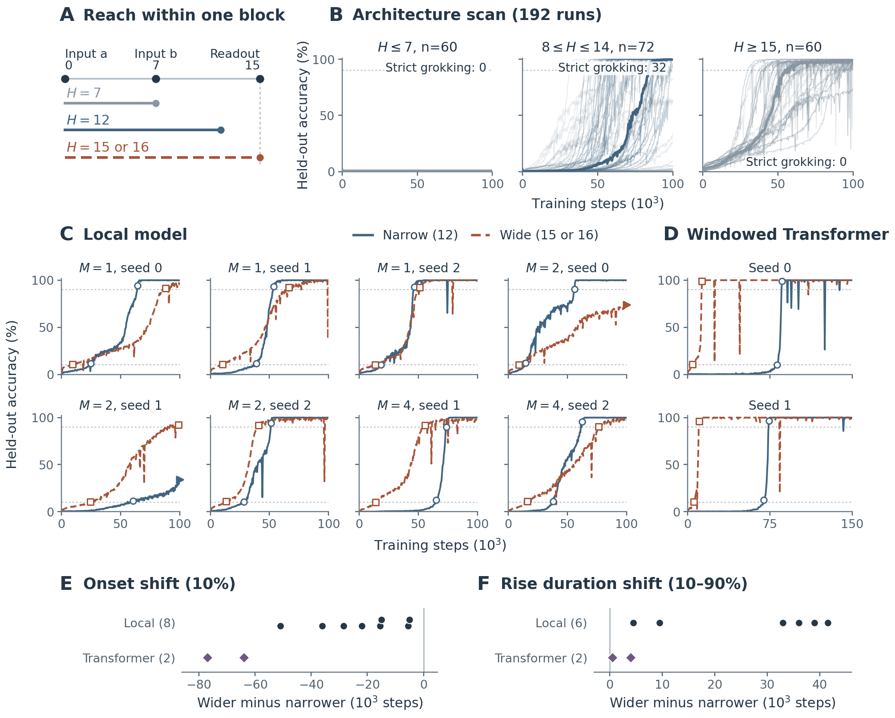

# 通信范围如何影响泛化的起步与上升历时

在模 59 加法实验中，扩大每层通信范围使 8 对局域模型均更早达到持续 10% 的留出集准确率。在两种范围均持续达到 90% 的 6 对中，从 10% 升到 90% 的历时均增加。两组同设备的窗口 Transformer 对照复现了这两个方向。



[矢量 PDF](../figures/14_communication_span_pairs.pdf)

## Figure legend

**Communication span shifts generalization onset and rise duration.** (A) One-block reach from input position 0 for representative spans. The second input and readout occupy positions 7 and 15. (B) Held-out accuracy for all 192 archived local-model runs. Thin lines show individual runs, dark blue thin lines identify runs that meet the original strict grokking criterion, and thick lines show medians. The strict counts are 0/60, 32/72, and 0/60 in order of increasing span. The recorded architecture configurations can share initial weights. (C) All eight matched local-model pairs selected from the scan in B. Each pair holds the initial weights, data split, device, and numerical settings fixed. The solid line uses a span of 12, and the dashed line uses a span of 15 or 16. M is the number of propagation modes. (D) Both same-device windowed Transformer pairs, with window 12 versus 15. Open symbols in C and D show the first of three consecutive evaluations at or above 10% or 90%. Evaluations are 500 steps apart. Triangles mark runs that had yet to reach sustained 90% by the end of training. (E) Change in time to sustained 10% with the wider span, for eight local pairs and two Transformer pairs. (F) Change in time from sustained 10% to sustained 90%, for the six local and two Transformer pairs that reach both thresholds under both conditions. Each point in E and F is one pair.

## 为什么以 12 格为配对基准

第一个输入距读出位置 15 格。基准设置每层传播 4 轮、每轮半径 3 格，总范围是 12 格。增加一轮可达 15 格，保持轮数而把半径扩大一格可达 16 格。这两种调整均使最远输入在一层内可达读出位置。对照比较的是从这一基准扩大范围的效果，适用条件是图中的输入布局、模型和训练任务。

## 数据与复现

- [原始架构扫描](../results/original_architecture_scan_192/runs_192.csv)与[可移植训练日志索引](../experiments/run_index.csv)中的 `architecture_scan` 条目。
- [窗口 Transformer 的历史记录和训练来源](../experiments/transformer_followup_20261115/records/)。图 D 使用 T1 的种子 0 和 1。种子 2 的两条运行使用不同设备。
- [绘图脚本](../scripts/redraw_communication_span.py)保留 8 组局域配对及两组 Transformer 配对的筛选结果。在仓库根目录运行以下命令，从已归档的训练记录生成 PNG 和 PDF。

```bash
python scripts/redraw_communication_span.py
```

脚本将图写入 `reproduced/communication_span/`。成功时会报告 192 条扫描记录、8 组局域配对（6 组可比上升历时）和 2 组 Transformer 配对。绘图使用 NumPy 与 Matplotlib，在 Python 3.12.7、NumPy 1.26.4、Matplotlib 3.9.2 下核验。
